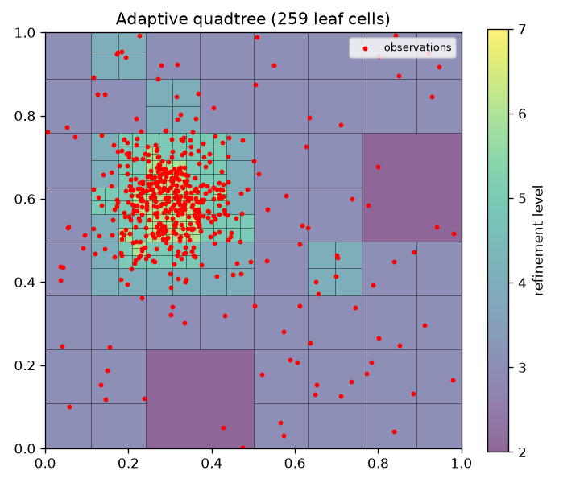
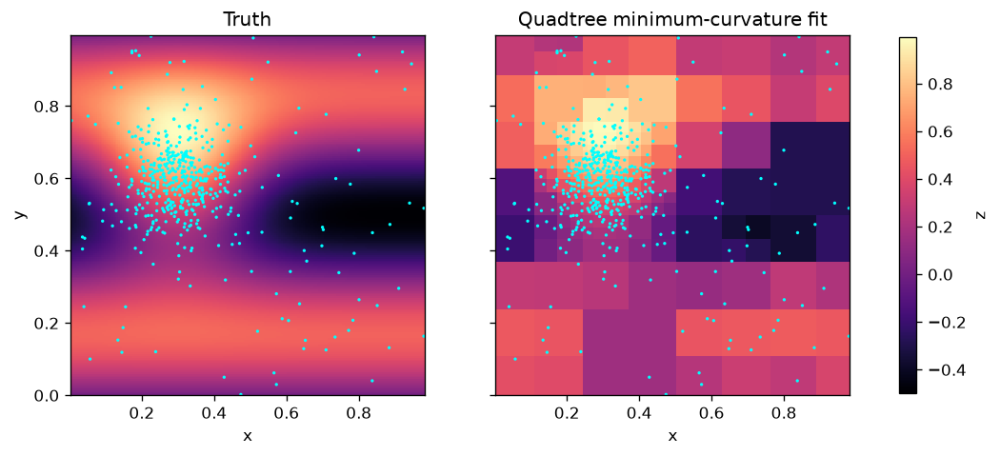

# Example: adaptive quadtree gridding

This example fits a synthetic dataset. The snippet uses uniform sampling for
brevity; the plots come from `examples/plot_quadtree.py`, which clusters the
samples in one area so the refinement is visible. Rerun it from the repository
root to regenerate the plots (it needs `matplotlib`):

```sh
python -m pip install matplotlib
python examples/plot_quadtree.py
```

```python
import numpy as np
from quadtree_minimum_curvature import QuadtreeMinCurvatureGridder

rng = np.random.default_rng(42)
x = rng.uniform(0, 1, 500)
y = rng.uniform(0, 1, 500)
z = np.exp(-((x - 0.3) ** 2 + (y - 0.6) ** 2) / 0.05)

gridder = QuadtreeMinCurvatureGridder(
    x, y, z, max_level=7, points_per_leaf=4, smooth_weight=0.1,
).fit()

cells = gridder.quadtree()    # dict of NumPy arrays, one entry per leaf cell
X, Y, Z = gridder.grid(nx=200, ny=200)
```

`quadtree()` returns the keys `x0`, `y0`, `size`, `level`, `count` and `value`.
Each leaf is a square of edge `size` with lower-left corner `(x0, y0)`; the
leaves tile the root cell, and `value` is the constant that `predict` returns
inside that cell.

## Refinement

The tree splits cells holding more than `points_per_leaf` observations, down to
`max_level`. Dense clusters therefore get small cells, while sparse regions keep
large ones:



## Fitted surface

The left panel is the true surface, sampled at the observation locations (cyan).
The right panel is the gridded minimum-curvature fit. Its piecewise-constant
cells are coarse in sparse areas, as described in the [README](../README.md):


